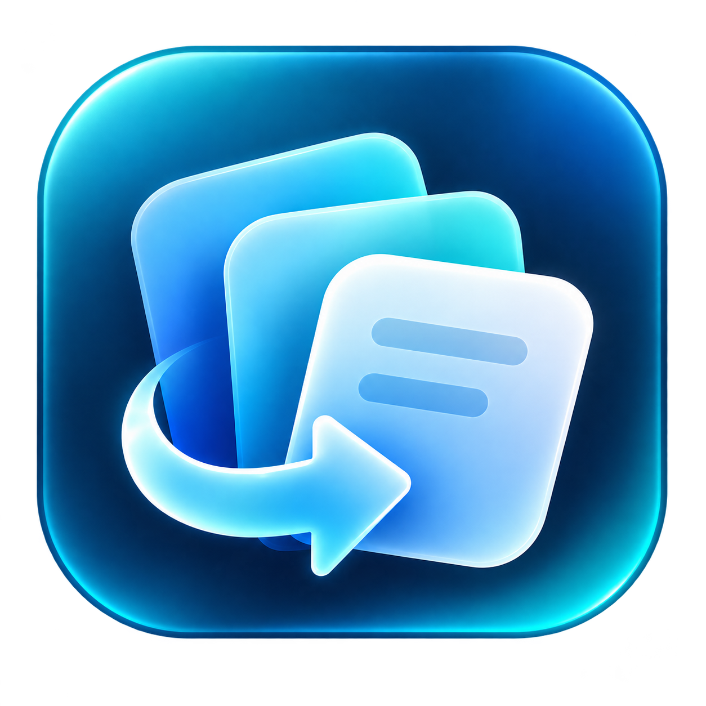

  

  <b>Transformo problemas do dia a dia em ferramentas que ajudam de verdade.</b> 
  Aplicativos, experimentos e aprendizado compartilhado — com atenção à utilidade, à privacidade e à experiência de quem usa.

  <a href="#em-construcao">Projeto em destaque</a> &nbsp; / &nbsp;
  <a href="#como-eu-construo">Como eu construo</a> &nbsp; / &nbsp;
  <a href="https://github.com/kushhoficial?tab=repositories">Repositórios</a> &nbsp; / &nbsp;
  <a href="https://www.linkedin.com/in/bruno-nascimento-0a67ba199/">Contato</a>

---

### 01 / CRIAR COM PROPÓSITO

Sou **Kush**, criador por trás de **@kushhoficial**. Este é meu espaço para transformar curiosidade em projetos, testar ideias e compartilhar o que aprendo construindo.

Gosto de ferramentas que resolvem uma necessidade concreta: reduzir tarefas repetitivas, tornar uma interface mais simples ou recuperar algo importante na hora certa. Meu objetivo é criar projetos que outras pessoas possam entender, usar e melhorar.

<table>
<tr>
<td width="33%" valign="top"><b>Utilidade</b>  Começar pelo problema real e construir uma solução simples de usar.</td>
<td width="33%" valign="top"><b>Experiência</b>  Cuidar dos detalhes, da clareza da interface e do caminho até a instalação.</td>
<td width="33%" valign="top"><b>Compartilhar</b>  Documentar decisões e preparar o código para receber outras ideias.</td>
</tr>
</table>

### 02 / PROJETO EM DESTAQUE

<table>
<tr>
<td width="120" align="center" valign="top"> </td>
<td valign="top">
<h3>Copilume</h3>

<b>Copie agora. Reencontre depois.</b>

Um histórico local da área de transferência para macOS. Textos, links e imagens ficam ao alcance de <b>Option + V</b>, com busca instantânea e uma interface nativa.

<code>Swift</code> <code>AppKit</code> <code>macOS</code> <code>MIT</code>

<b>Estado:</b> publicado em código aberto, sob licença MIT. <a href="https://github.com/kushhoficial/Copilume">Ver código e documentação</a> · <a href="https://github.com/kushhoficial/Copilume/releases/latest">Baixar para macOS</a>.

</td>
</tr>
</table>

<b>O que já está implementado no Copilume</b>

- Histórico de textos, links e imagens, com miniaturas e filtros.
- Busca, navegação pelo teclado e itens fixados.
- Histórico apenas em memória por padrão; armazenamento local opcional.
- Colagem no aplicativo anterior com autorização de Acessibilidade do macOS.
- Aplicativo universal para Apple Silicon e Intel, compilado localmente.

O projeto está em evolução. A distribuição atual usa assinatura local, sem notarização Apple; compatibilidade e limitações serão documentadas junto da publicação.

### 03 / COMO EU CONSTRUO

**Entender → prototipar → testar → refinar → compartilhar.**

Prefiro uma primeira versão que funcione e possa ser melhorada com feedback. Busco dependências enxutas, decisões explicáveis e documentação que ajude alguém a começar sem precisar adivinhar o caminho.

> Uma ferramenta ganha valor quando deixa a vida de alguém um pouco mais simples.

### 04 / EXPLORE E PARTICIPE

- **[Repositórios](https://github.com/kushhoficial?tab=repositories)** — acompanhe os projetos disponíveis no perfil.
- **[LinkedIn](https://www.linkedin.com/in/bruno-nascimento-0a67ba199/)** — contato profissional e conversas sobre tecnologia.
- **[Contribuições](https://github.com/kushhoficial/kushhoficial/pulls)** — sugestões de melhoria para este perfil são bem-vindas por pull request.

<b>English / A quick introduction</b>

I'm **Kush**, the creator behind **@kushhoficial**. I build practical tools and experiments, learn by making, and aim to share projects that others can use and improve.

My current project is **Copilume**, a local clipboard history app for macOS built with Swift and AppKit. It supports text, links and images. The source code and macOS installer are available in the [Copilume repository](https://github.com/kushhoficial/Copilume).

Explore my repositories, connect on [LinkedIn](https://www.linkedin.com/in/bruno-nascimento-0a67ba199/), or suggest an improvement to this profile with a pull request.

---

<b>kushhoficial</b> &nbsp;·&nbsp; criar com propósito &nbsp;·&nbsp; aprender em movimento &nbsp;·&nbsp; compartilhar o caminho

